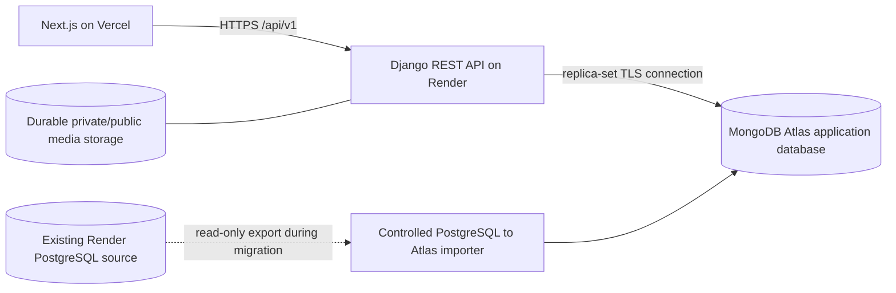
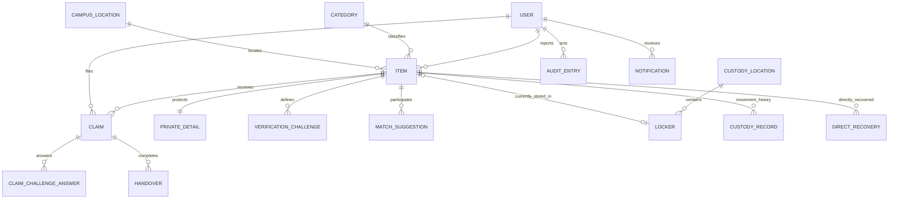

# MongoDB Atlas Data Architecture

**Design phase:** Phase 2
**Status:** Proposed for integration testing; not a production cutover plan.
**Target backend:** Django 5.2 with the official Django MongoDB Backend 5.2 release line.

## 1. Principles and cutover boundary

1. Keep Next.js and the active Django REST API. Preserve `/api/v1`, response shapes, UUID-based public IDs, authorization, and existing workflow states.
2. Use one MongoDB collection per concrete Django model. Keep each collection responsible for its existing lifecycle. Do not combine unrelated model types into polymorphic collections.
3. Keep PostgreSQL available as the migration source and rollback reference. MongoDB is not the default production database until the backend, imports, reconciliation, real integration tests, and deployment gates pass.
4. Preserve current domain UUIDs. Use Mongo-compatible generated ObjectIds only for Django framework/internal models whose current primary keys are AutoField/BigAutoField, unless a tested alternative can preserve those numeric IDs safely.
5. Keep durable workflow/history records as references in separate documents. Embed only bounded values that are always read with one parent and whose snapshot semantics are explicit.
6. Treat Mongo references as application-enforced links, not foreign-key constraints. Restrict deletion and validate related IDs in services.
7. No database, source application, Render/Vercel service, or production data was changed to prepare this design.

The selected backend version must match Django's major/minor version. The official v5.2 line documents `UUIDField`, `ForeignKey`, `OneToOneField`, and `ManyToManyField`; relations use `$lookup` for cross-collection reads, and MongoDB recommends embedding only when ownership, co-read patterns, and bounded size make that safe. See [v5.2 relationship guidance](https://www.mongodb.com/docs/languages/python/django-mongodb/v5.2/model-data/relationships/) and [v5.2 feature limitations](https://www.mongodb.com/docs/languages/python/django-mongodb/v5.2/limitations-upcoming/).

## 2. Deployment and database layout

- Atlas must be a replica set or sharded cluster before any multi-document transaction is exercised. A standalone MongoDB server is insufficient for the transaction guarantees required by handover/custody workflows.
- Use separate Atlas databases for development, automated tests, staging, and production; automated tests must never point at production.
- Use environment variables `MONGODB_URI` and `MONGODB_DATABASE`; credentials stay in Render's secret store. The URI must not enter frontend configuration, logs, documentation examples as a real value, or Git.
- Keep the existing PostgreSQL source read-only during export and reconciliation. Do not dual-write to PostgreSQL and MongoDB: there is no existing transactional outbox/CDC path to guarantee consistency.
- The production traffic cutover requires a separately approved maintenance window, a defined final PostgreSQL snapshot/replication procedure, and an explicit reconciliation gate.
- Keep public item images and private evidence out of MongoDB documents. Choose durable object storage or an approved persistent volume, copy files with checksums, retain current private authorization, and only then preserve/update their stored references. GridFS is unsupported by this backend line.

## 3. Collection and identifier strategy

Use stable collection names based on the current Django `app_label_modelname` table names so migration mapping and operations remain explicit. Final names must be confirmed by the backend's generated collection metadata before the importer is enabled.

### Domain identifiers

- Existing UUID primary keys remain UUID values in MongoDB and are returned to the frontend using the same string serialization.
- Foreign-key document references store the referenced UUID value, not an independently generated surrogate.
- Preserve registration numbers, item reference numbers, status strings, timestamps, encryption fields, and audit targets exactly after validation/normalization defined in the data-mapping document.
- MongoDB BSON dates have millisecond precision. PostgreSQL microseconds will be truncated to milliseconds; for equal timestamps, all chronological API queries must use an ID tie-breaker. No workflow may infer ordering from timestamp alone.
- Django framework models using AutoField/BigAutoField need the v5.2-supported `ObjectIdAutoField`/Mongo contrib migration configuration. Their old integer IDs are not public API IDs. Migrate users/groups/permissions by stable natural keys and rebuild junction references. Preserve existing custom `accounts.User` UUID IDs.
- Use the official backend's `UUIDField` representation. Do not convert IDs to strings inside MongoDB merely to simplify import; equality and FK lookups must use one canonical UUID BSON subtype. Verify UUID read/write/JWT/JWT-refresh/API round-trip before loading production data.

### Relationship and embedding decisions

Keep these records separate and referenced:

- **User, item, claim, verification challenge, answer, custody location, locker, custody record, handover, direct recovery, disposal, match, audit entry and notification.** They have independent authorization, lifecycle, or history. Embedding them would make updates/deletes, append-only history, and cross-user access boundaries harder to preserve.
- **Claim challenge answers remain separate** because provided answers are sensitive, are tied to a specific challenge, and must remain separately permissioned. They must never be copied into public report snapshots or audit metadata.
- **Custody records and audit entries remain append-only event documents.** Do not embed unbounded histories into item documents; this would create a hot, growing parent document and weaken event preservation.
- **Framework auth groups/permissions remain separately modeled** with their existing M2M relationships unless real v5.2 tests demonstrate an equivalent safe representation. The app's existing role field remains the primary application RBAC value.

Bounded values may remain in their current parent document: `Item.additional_images`, `MatchSuggestion.explanation`, `Claim.private_evidence_proof_urls`, `DirectRecovery.verification_methods`/`verified_challenge_ids`, and `AuditEntry.metadata`. Keep them bounded and sanitize metadata as today. A JSON object is not an untyped embedded Django model; do not change JSON semantics without a specific migration and tests.

For completed handover receipts, preserve immutable item, recipient, approving officer, handover officer, custody location, and locker values as a typed snapshot in the handover/recovery record (or existing immutable custody fields where they already provide the same data). Keep canonical UUID references alongside the snapshot. The snapshot must represent the locker/location immediately before release and must not be overwritten when a locker is reused.

Category/location display snapshots may be introduced only as a read optimization after API behavior is verified. They are not the source of truth and must not silently go stale after admin edits. First test indexed FK reads; do not denormalize mutable taxonomy just to eliminate `$lookup` without a synchronization design.

## 4. Referential integrity and deletion policy

MongoDB does not provide the relational FK enforcement used by PostgreSQL. Preserve the current `PROTECT`, `SET_NULL`, and `CASCADE` behavior in application services:

- Keep users, reporters, claimants, reviewers, officers, audit actors, and recipients referenced by history. Deactivate or retain records rather than deleting referenced accounts.
- Keep item/category/location records referenced by claims, verification, custody, handovers, disposal, matches, or audit history. Existing model protection and soft archive/withdraw/expire states remain in force.
- Enforce required references on every create/update service and importer pass. Report dangling references before import; do not insert partially related workflow documents.
- Make deletion a privileged service operation with dependency checks; do not rely on ORM cascades spanning collections for critical records.
- For collection imports, load referenced entities first, validate each referenced UUID, then load dependent records in topological order. Reconcile both forward references and reverse orphan counts.

## 5. Transactions and concurrency architecture gate

This architecture does not claim that replacing `django.db.transaction` with the custom backend API preserves the existing behavior. Phase 3 must produce and test that replacement before Phase 4 enables the engine.

- Prefer a single-document atomic conditional update for one-record state transitions, such as consuming a matching, unexpired OTP only when its current status and retry count match.
- Enforce duplicate prevention with verified unique indexes in addition to service-level validation.
- For multi-document operations (claim approval, direct/normal handover, item/locker/custody changes), use the official Mongo transaction API only on a replica-set/sharded deployment, at the outermost service boundary. Do not rely on nested atomic blocks or row locks.
- Use explicit compare-and-set state/version predicates, stable idempotency keys, transient transaction retry handling, and post-commit notification dispatch. Failed/retried attempts must not emit duplicate notifications or audit records.
- Do not record a successful handover until OTP use, handover record, item state, locker release, custody history, recovery state, and audit event are committed consistently.
- For the last-super-admin rule, serialize privileged changes through a Mongo-safe conditional control record or an equivalent database-enforced invariant; checking a count and then saving a user is race-prone.
- Phase 6 concurrency evidence must use a real isolated MongoDB replica set with simultaneous requests and inspect persisted final state. SQLite, unit mocks, and sequential-only tests do not satisfy this gate.

## 6. Read/query and pagination strategy

- Preserve the existing `/api/v1` request/response contract, permission scopes, search semantics, ordering, and `page`/`limit` parameters.
- Keep `select_related()`-equivalent reads only where needed; benchmark `$lookup` in list endpoints. Replace unsupported `prefetch_related()` with explicit bounded batched reads, or an explicitly designed typed snapshot.
- Add deterministic sort keys: existing timestamp/order field plus UUID. Keep history ordered even when dates collide at millisecond precision.
- Keep existing page pagination for compatibility. Measure count and deep-page cost on representative data; introduce internal keyset pagination only if it can preserve the external contract and be migrated safely.
- Treat `icontains` as a supported string predicate, not an indexed full-text solution. Add ordinary compound indexes for structured filters first. If Atlas Search is later selected for free-text search, prove parity for tokenization, substring behavior, sorting, permissions, and empty queries before switching API behavior.
- Keep analytics outputs defined from persisted source records. Re-test filtered aggregates, JSON subfield lookups, `Count`, `.values()` joins, and time ordering. No denormalized counters are proposed in this phase.

## 7. Security and operations

- Keep JWT signing keys, field encryption key, MongoDB URI, and storage credentials server-side in Render environment secrets.
- The current app-level append-only audit manager is retained, but it is not equivalent to the PostgreSQL trigger. Deployment must use a least-privilege runtime role with insert/read but no update/delete on the audit collection, plus a separate migration role. Verify this role design against the selected Atlas tier and runtime behavior before claiming immutable audit storage.
- App DB credentials must not be shared with a general-purpose administrator or migration identity. Atlas users must have only the required database actions and network access limited to the Render service.
- Keep encrypted `PrivateDetail` values and OTP hashes/ciphertext byte-for-byte; never log secret plaintext. MongoDB server-side field-level encryption is not assumed because v5.2 documents it as unsupported through this backend.
- Back up Atlas before cutover, enable monitoring, and rehearse point-in-time recovery using staging data.

## 8. Readiness decision

**Architecture status: DEFINED for implementation planning; NOT VERIFIED against MongoDB.**

Phase 2 records a conservative reference-first data design and identifies bounded embedded values and receipt snapshots. It does not establish that current models/migrations/querysets work on the backend. Phase 3 concurrency redesign and a real Atlas test replica set remain gates. Production remains on PostgreSQL until all later phases are verified and cutover is explicitly authorized.

## Official references

- [Django MongoDB Backend v5.2 relationships and denormalization](https://www.mongodb.com/docs/languages/python/django-mongodb/v5.2/model-data/relationships/)
- [Django MongoDB Backend v5.2 UUID and field support](https://www.mongodb.com/docs/languages/python/django-mongodb/v5.2/model-data/models/)
- [Django MongoDB Backend v5.2 compatibility limitations](https://www.mongodb.com/docs/languages/python/django-mongodb/v5.2/limitations-upcoming/)
- [Django MongoDB Backend v5.2 transactions](https://www.mongodb.com/docs/languages/python/django-mongodb/v5.2/interact-data/transactions/)
