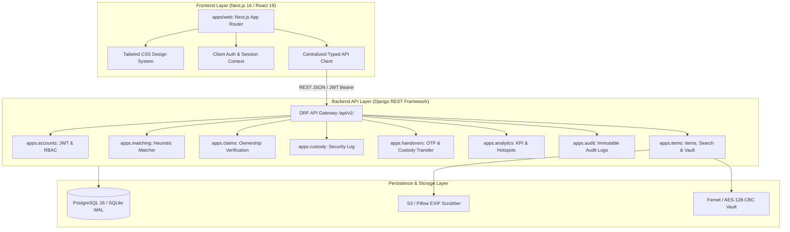

# System Architecture: LPU Lost & Found Property Recovery Platform

## 1. High-Level Architecture Overview

The LPU Lost & Found Management System is architected as a modern, decoupled client-server platform tailored for the Lovely Professional University campus ecosystem (~35,000+ students and faculty across 600+ acres).

---

## 2. Component Breakdown

### 2.1 Frontend (`apps/web`)
- **Framework:** Next.js 16.4 with React 19 and Turbopack compiler.
- **Routing:** App Router architecture supporting 19 distinct routes across role-specific dashboards:
  - **Public:** Landing (`/`), Search Board (`/board`), Item Detail (`/items/[id]`), Login (`/login`), Registration (`/register`).
  - **Student / Reporter:** Report item (`/report`), Personal claims (`/dashboard/my-claims`), Personal reports (`/dashboard/my-reports`), Matches (`/dashboard/matches`).
  - **Security Officer:** Claims triage (`/security/claims`), Physical custody logging (`/security/custody`), OTP verification & handover modal (`/security`).
  - **Administrator:** User management (`/admin/users`), Campus items control (`/admin/items`), Audit log monitor (`/admin/audit`), Recovery analytics (`/admin/analytics`).
- **Styling & Design System:** Tailored Vanilla/Tailwind CSS styling utilizing LPU branding (authentic university palette, responsive grid, accessible modal dialogs, and toast notifications).
- **Client Resilience:** Unified typed API client with token refresh handling, client-side input validation, and asynchronous mounting cancellation guards to eliminate race conditions.

### 2.2 Backend (`backend/`)
- **Framework:** Python 3.14 with Django 5.2 and Django REST Framework 3.15.
- **API Pattern:** Standardized RESTful envelope with version prefix `/api/v1/`.
- **Database Engine:** Relational database with full ACID compliance (PostgreSQL in staging/production, SQLite in local dev/testing).
- **Authentication & Authorization:**
  - Stateless JSON Web Tokens (`djangorestframework-simplejwt`) with short-lived access tokens and refresh rotation.
  - Role-Based Access Control (RBAC) enforced via custom DRF permission classes (`IsStudentStaff`, `IsSecurityOfficer`, `IsAdminUser`).
  - Strict object-level ownership guards preventing unauthorized modifications.
- **Privacy & Security Vault:**
  - Two-tier property privacy model: public descriptive attributes (category, general location, brand, general color) vs. private identifying attributes (serial numbers, engravings, phone lock screens, student ID cards).
  - Private attributes are encrypted using Fernet (AES-128-CBC + HMAC-SHA256) before database insertion and never serialized to public search endpoints.
  - Image uploads processed through an in-memory Pillow pipeline that strips all EXIF and GPS geolocation metadata.

### 2.3 Handover & Custody Workflow
1. **Found Item Logged:** Item status set to `REPORTED` or `IN_CUSTODY`.
2. **Claim Submitted:** Claimant provides secret verification answers. Claim status `UNDER_REVIEW`.
3. **Security Review:** Security officer compares claimant proof against the decrypted vault.
4. **Approval & OTP Generation:** If verified, security approves the claim (`APPROVED`). The claimant's dashboard displays a cryptographically generated single-use 6-digit OTP.
5. **Physical Handover:** The student presents the OTP in person at the campus security desk. The security officer enters the OTP into the system.
6. **Immutable Transfer:** The backend validates the OTP in an atomic database transaction, transitions item status to `HANDED_OVER`, generates a digital handover receipt, and records the event in the audit log.
