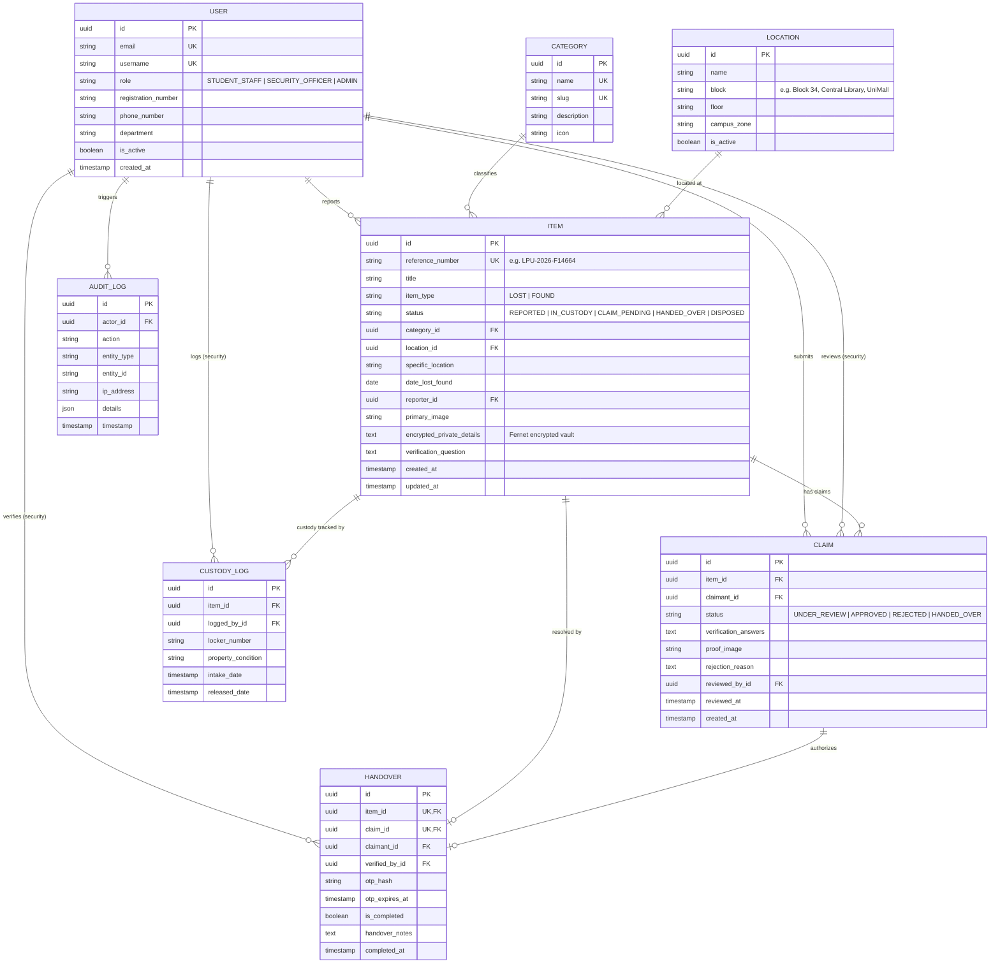

# Database Design & Entity Relationships: LPU Lost & Found

The relational schema is engineered for data integrity, multi-actor role separation, privacy vaults, and complete auditability.

## 1. Entity-Relationship Diagram (ERD)

---

## 2. Integrity Constraints & Invariants

1. **Anti-Self-Claim Invariant:** A user cannot submit an ownership claim against an item they reported (`reporter_id != claimant_id`). Enforced at model validation and serializer layer.
2. **Duplicate Active Claim Prevention:** A user may not open multiple concurrent active claims on the same item.
3. **Single Handover Constraint:** Each item can only be handed over once via an `OneToOneField` relationship between `Item` and `Handover`.
4. **Encrypted Private Vault:** High-risk identifying attributes (serial numbers, laptop MAC addresses, phone lock wallpapers) are encrypted with Fernet (AES-128-CBC) prior to storage.
5. **Single-Use Handover OTP:** The 6-digit OTP is cryptographically hashed, expires after 15 minutes, and is marked completed in an atomic database transaction upon verification.
