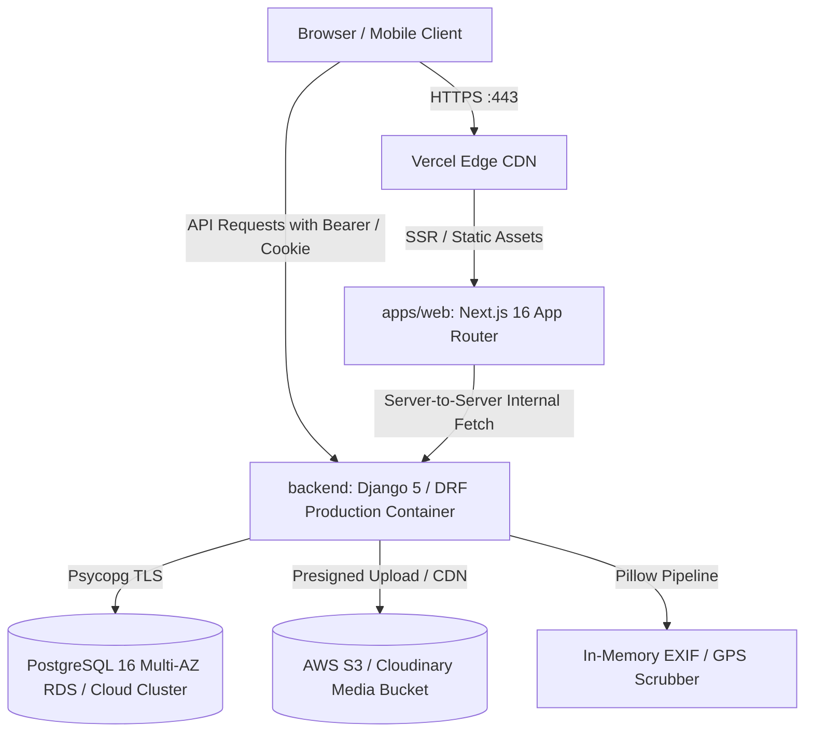

# LPU Lost & Found Property Recovery Platform
## Production Deployment, Operations & Runbook

This guide covers production deployment topologies, cloud infrastructure configuration, security baselines, database indexing, backup/restore procedures, and operational smoke testing for the **LPU Lost & Found** campus property recovery platform (Next.js 16 App Router + Django REST Framework).

---

## 1. System Architecture & Topology



- **Frontend (`apps/web`)**: Deployed to **Vercel** with automatic preview deployments, static page prerendering, Turbopack optimizations, and strict security headers via `vercel.json`.
- **Backend (`backend/`)**: Deployed as a containerized Python web service to **Render** (or AWS ECS/Fargate / DigitalOcean App Platform) using `backend/Dockerfile` or `backend/render.yaml`.
- **Database**: **PostgreSQL 16** managed database cluster with TLS 1.3, connection pooling (`dj-database-url`), and automated continuous backups.
- **Image Storage & Processing**: Multipart upload ingestion -> In-memory Pillow processing (EXIF & GPS metadata stripped, resized, converted to WebP) -> S3 / persistent media storage.

---

## 2. Environment Variables Specification

### 2.1 Backend (`backend/.env`)

| Variable | Required | Default / Example | Purpose |
| :--- | :---: | :--- | :--- |
| `DJANGO_ENV` | Yes | `production` | Enables production mode and strict security guards |
| `DEBUG` | Yes | `False` | Disables debug tracebacks and detailed internal exceptions |
| `SECRET_KEY` | Yes | `openssl rand -hex 32` (>=50 chars) | Core cryptographic secret for Django session & token signatures |
| `JWT_SIGNING_KEY` | Yes | `openssl rand -hex 32` (>=32 chars) | Cryptographic key for signing HS256 authentication tokens |
| `DATABASE_URL` | Yes | `postgresql://<user>:<pwd>@<host>:5432/<dbname>` | PostgreSQL connection string with SSL |
| `ALLOWED_HOSTS` | Yes | `.onrender.com,api-lostfound.lpu.in,localhost` | Comma-delimited list of valid HTTP Host header values |
| `CORS_ALLOWED_ORIGINS`| Yes | `https://lpu-lost-found.vercel.app,https://lostfound.lpu.in` | Comma-delimited list of allowed browser origins |
| `CSRF_TRUSTED_ORIGINS`| Yes | `https://lpu-lost-found.vercel.app,https://*.onrender.com` | Permitted cross-site POST origins for CSRF defense |
| `FIELD_ENCRYPTION_KEY`| Yes | `openssl rand -hex 32` (exact 64 hex chars = 32 bytes) | AES-256-GCM symmetric key for private detail vaults |
| `SECURE_SSL_REDIRECT` | Yes | `True` | Forces all HTTP traffic to HTTPS via 301 redirect |
| `SESSION_COOKIE_SECURE`| Yes | `True` | Requires HTTPS before transmitting session cookies |
| `CSRF_COOKIE_SECURE` | Yes | `True` | Requires HTTPS before transmitting CSRF cookies |
| `SECURE_HSTS_SECONDS` | No | `31536000` | HTTP Strict Transport Security (HSTS) duration (1 year) |

### 2.2 Frontend (`apps/web/.env.production` / Vercel Environment Variables)

| Variable | Required | Default / Example | Purpose |
| :--- | :---: | :--- | :--- |
| `NEXT_PUBLIC_API_URL` | Yes | `https://<backend-domain>/api/v1` | Public backend REST API base URL |
| `NEXT_PUBLIC_APP_NAME`| No | `LPU Lost & Found Campus Property Recovery Platform` | Brand display title |
| `NEXT_PUBLIC_CAMPUS_NAME`| No | `Lovely Professional University, Phagwara, Punjab` | University campus location |
| `NEXT_PUBLIC_SECURITY_HOTLINE`| No | `+91 1824 517000` | Campus emergency / security reception phone |

---

## 3. Database Migrations & Model Indexes

All model tables and indexes are managed through standard reviewed Django migrations:

```bash
# Verify migrations are up to date and in sync with models
python backend/manage.py makemigrations --check --dry-run

# Apply all migrations during deployment
python backend/manage.py migrate --noinput
```

### Essential Indexes Created:
1. **`accounts_user`**:
   - `email` (unique constraint)
   - `registration_number` (unique constraint)
   - `role` (index for RBAC filtering)
2. **`items_item`**:
   - `reference_number` (unique constraint)
   - `status`, `item_type` (compound index for board filtering)
   - `category_id`, `location_id` (foreign key indexes)
   - `created_at` (reverse chronological sorting)
3. **`claims_claim`**:
   - `item_id`, `claimant_id` (foreign key indexes)
   - `claim_status` (security queue indexing)
4. **`matching_matchsuggestion`**:
   - `lost_item_id`, `found_item_id` (unique constraint, prevents duplicate matches)
   - `score` (descending score ranking)
5. **`custody_custodyrecord`**:
   - `item_id`, `created_at` (chronological custody timeline per item)
6. **`handovers_handover`**:
   - `item_id`, `claim_id` (foreign key indexes)
   - `is_completed` (pending handover queue indexing)
7. **`audit_auditentry`**:
   - `timestamp` (forensic audit ordering)
   - `actor_id`, `action` (admin filter indexing)

---

## 4. Backup, Disaster Recovery & Retention

### 4.1 Automated PostgreSQL Daily Backups
Ensure PostgreSQL continuous backup is enabled on your cloud host (e.g., Render, AWS RDS, Supabase):
- **Continuous WAL Archiving**: Point-in-time recovery (PITR) within a 7-day rolling window.
- **Daily Automated Snapshots**: Stored in multi-region cold storage for 30 days.

### 4.2 Manual Database Export (`pg_dump`)
```bash
# Encrypted production export
pg_dump "$DATABASE_URL" --format=custom --no-owner --no-acl --file="backup_lpu_$(date +%Y%m%d_%H%M%S).dump"
```

### 4.3 Database Restoration (`pg_restore`)
```bash
# Restore to staging or disaster recovery instance
pg_restore --clean --if-exists --no-owner --no-acl --dbname="$DATABASE_URL" backup_lpu_20261018.dump
```

### 4.4 Statutory Retention & Automatic Disposal Policy
Items in `LOST` or `UNCLAIMED_FOUND` state are governed by campus retention policies:
- High-value electronics: 90 days
- Standard accessories & clothing: 60 days
- Documents & Books: 180 days
Administrative users review the Ageing Queue (`/admin/items`) and execute approval-backed disposal or donation.

---

## 5. Deployment Procedures

### 5.1 Backend Deployment (Render / Docker)
1. In **Render Dashboard**:
   - Select **New +** -> **Blueprint**.
   - Connect repository and select [`backend/render.yaml`](file:///c:/Users/kumar/Desktop/lpu-lost-and-found/backend/render.yaml).
   - Alternatively, create a **Web Service**:
     - Environment: `Python` (or `Docker` using `backend/Dockerfile`)
     - Build Command: `pip install -r requirements.txt && python manage.py collectstatic --noinput && python manage.py migrate --noinput`
     - Start Command: `gunicorn config.wsgi:application --bind 0.0.0.0:$PORT --workers 3`
2. Configure Environment Variables in the Render Settings (see section 2.1).
3. Deploy and verify health check at:
   `https://<your-render-service>.onrender.com/api/v1/health`

### 5.2 Frontend Deployment (Vercel)
1. In **Vercel Dashboard**:
   - Select **Add New...** -> **Project**.
   - Select the repository.
   - Root Directory: `apps/web`.
   - Framework Preset: `Next.js`.
2. Configure Environment Variables:
   - `NEXT_PUBLIC_API_URL=https://<your-render-service>.onrender.com/api/v1`
3. Click **Deploy**.
4. Test cross-origin authentication by visiting the login route.

---

## 6. Operational Smoke Testing

Once deployment completes, execute the automated deployment smoke test suite against the target URL:

```bash
# Run against the production API
node scripts/deployment-smoke-test.mjs https://<your-api-domain>.com
```

The smoke test verifies 7 critical health and security boundaries:
1. Root Welcome Endpoint (HTTP 200, operational envelope)
2. Health Check & Database Connectivity (HTTP 200, state: `CONNECTED`)
3. Public Item Search Board (HTTP 200, zero private field leakage)
4. Campus Item Categories catalog (HTTP 200)
5. Campus Locations catalog (HTTP 200)
6. Security Claims Queue unauthenticated access guard (HTTP 401 Unauthorized)
7. Administrative Analytics unauthenticated access guard (HTTP 401 Unauthorized)
